```mermaid
%% Generated by https://gitdiagram.com/bhangun/andalus-framework
flowchart TD

subgraph group_agents["Agents and workflows"]
  node_agent["Agent strategies"]
  node_orchestrator["Agent orchestrator"]
  node_workflow["Workflow engine"]
end

subgraph group_runtime["Execution and tools"]
  node_execution["Execution pipeline"]
  node_engine["Execution engine"]
  node_inference["Inference routing"]
  node_tools["Tool invocation"]
  node_plugins["Plugin lifecycle"]
end

subgraph group_protocols["Agent communication"]
  node_communication["Communication API"]
  node_a2a["A2A adapter"]
  node_anp["ANP protocol"]
  node_network["Agent network"]
end

subgraph group_knowledge["Knowledge and memory"]
  node_knowledge["Knowledge services"]
  node_rag["RAG pipeline<br/>[RagPipeline.java]"]
  node_memory["Memory manager"]
  node_embedding["Embedding service"]
end

subgraph group_governance["Security and operations"]
  node_security["Authorization"]
  node_guardrails["Guardrails"]
  node_audit["Audit services<br/>[AuditService.java]"]
  node_observability["Tracing"]
end

node_developer(("Framework builder"))

node_developer -.->|"builds agents"| node_agent
node_developer -.->|"defines workflows"| node_workflow
node_agent -.->|"orchestrated by"| node_orchestrator
node_workflow -.->|"workflow execution"| node_engine
node_execution -.->|"invokes models"| node_inference
node_execution -.->|"runs tools"| node_tools
node_communication -.->|"protocol adapter"| node_a2a
node_communication -.->|"protocol adapter"| node_anp
node_network -.->|"supports networking"| node_anp
node_rag -.->|"embeds content"| node_embedding

click node_agent "https://github.com/bhangun/andalus-framework/tree/main/framework/andalus-agent/src/main/java/tech/kayys/andalus/agent"
click node_orchestrator "https://github.com/bhangun/andalus-framework/blob/main/framework/andalus-agent/src/main/java/tech/kayys/andalus/agent/orchestration/AgentOrchestrator.java"
click node_workflow "https://github.com/bhangun/andalus-framework/blob/main/framework/andalus-workflow/src/main/java/tech/kayys/andalus/workflow/WorkflowEngine.java"
click node_execution "https://github.com/bhangun/andalus-framework/blob/main/framework/andalus-execution-core/src/main/java/tech/kayys/andalus/execution/core/DefaultExecutionPipeline.java"
click node_engine "https://github.com/bhangun/andalus-framework/blob/main/framework/andalus-engine/src/main/java/tech/kayys/andalus/execution/ExecutionEngine.java"
click node_inference "https://github.com/bhangun/andalus-framework/blob/main/framework/andalus-provider/src/main/java/tech/kayys/andalus/inference/InferenceService.java"
click node_tools "https://github.com/bhangun/andalus-framework/blob/main/framework/andalus-tool/src/main/java/tech/kayys/andalus/tool/ToolInvocation.java"
click node_plugins "https://github.com/bhangun/andalus-framework/blob/main/framework/andalus-plugin/src/main/java/tech/kayys/andalus/plugin/DefaultPluginLifecycleManager.java"
click node_communication "https://github.com/bhangun/andalus-framework/blob/main/framework/andalus-communication-api/src/main/java/tech/kayys/andalus/communication/api/AgentCommunicator.java"
click node_a2a "https://github.com/bhangun/andalus-framework/blob/main/framework/andalus-a2a/src/main/java/tech/kayys/andalus/a2a/adapter/A2AAgentAdapter.java"
click node_anp "https://github.com/bhangun/andalus-framework/tree/main/framework/andalus-anp/src/main/java/tech/kayys/andalus/anp"
click node_network "https://github.com/bhangun/andalus-framework/blob/main/framework/andalus-agent-network-core/src/main/java/tech/kayys/andalus/network/core/DefaultAgentNetwork.java"
click node_knowledge "https://github.com/bhangun/andalus-framework/tree/main/framework/andalus-knowledge/src/main/java/tech/kayys/andalus/knowledge"
click node_rag "https://github.com/bhangun/andalus-framework/blob/main/framework/andalus-rag/src/main/java/tech/kayys/andalus/rag/spi/RagPipeline.java"
click node_memory "https://github.com/bhangun/andalus-framework/blob/main/framework/andalus-memory/src/main/java/tech/kayys/andalus/memory/manager/DefaultMemoryManager.java"
click node_embedding "https://github.com/bhangun/andalus-framework/blob/main/framework/andalus-embedding/src/main/java/tech/kayys/andalus/embedding/EmbeddingService.java"
click node_security "https://github.com/bhangun/andalus-framework/blob/main/framework/andalus-security-core/src/main/java/tech/kayys/andalus/security/policy/PolicyAuthorizationService.java"
click node_guardrails "https://github.com/bhangun/andalus-framework/blob/main/framework/andalus-guardrails/src/main/java/tech/kayys/andalus/guardrails/GuardrailsService.java"
click node_audit "https://github.com/bhangun/andalus-framework/blob/main/framework/andalus-audit/src/main/java/tech/kayys/andalus/audit/AuditService.java"
click node_observability "https://github.com/bhangun/andalus-framework/blob/main/framework/andalus-observability/src/main/java/tech/kayys/andalus/tracing/TracingService.java"

classDef toneNeutral fill:#f8fafc,stroke:#334155,stroke-width:1.5px,color:#0f172a
classDef toneBlue fill:#dbeafe,stroke:#2563eb,stroke-width:1.5px,color:#172554
classDef toneAmber fill:#fef3c7,stroke:#d97706,stroke-width:1.5px,color:#78350f
classDef toneMint fill:#dcfce7,stroke:#16a34a,stroke-width:1.5px,color:#14532d
classDef toneRose fill:#ffe4e6,stroke:#e11d48,stroke-width:1.5px,color:#881337
classDef toneIndigo fill:#e0e7ff,stroke:#4f46e5,stroke-width:1.5px,color:#312e81
classDef toneTeal fill:#ccfbf1,stroke:#0f766e,stroke-width:1.5px,color:#134e4a
class node_agent,node_orchestrator,node_workflow toneBlue
class node_execution,node_engine,node_inference,node_tools,node_plugins toneAmber
class node_communication,node_a2a,node_anp,node_network toneMint
class node_knowledge,node_rag,node_memory,node_embedding toneRose
class node_security,node_guardrails,node_audit,node_observability,node_developer toneIndigo

```

```mermaid
%% Generated by https://gitdiagram.com/bhangun/andalus-framework
flowchart TD

subgraph group_agents["Agents and workflows"]
  node_agent["Agent strategies"]
  node_orchestrator["Agent orchestrator"]
  node_workflow["Workflow engine"]
end

subgraph group_execution["Execution and inference"]
  node_execution_api["Execution contracts"]
  node_execution_core["Execution pipeline"]
  node_engine["Execution engine"]
  node_inference["Inference routing"]
  node_provider["Model providers<br/>[Provider.java]"]
  node_tools["Tool invocation"]
end

subgraph group_communication["Communication protocols"]
  node_communication["Communicator contracts"]
  node_network["Agent network"]
  node_a2a["A2A adapter"]
  node_anp["ANP adapter"]
end

subgraph group_knowledge["Knowledge and memory"]
  node_embedding["Embedding service"]
  node_rag["RAG pipeline<br/>[RagPipeline.java]"]
  node_knowledge["Knowledge services"]
  node_memory["Memory management"]
end

subgraph group_controls["Security and operations"]
  node_security["Authorization policy"]
  node_guardrails["Guardrails"]
  node_audit["Audit services<br/>[AuditService.java]"]
  node_tracing["Tracing"]
end

node_app(("Framework user"))

node_app -->|"builds agents"| node_agent
node_app -->|"orchestrates"| node_orchestrator
node_app -->|"executes workflow"| node_workflow
node_inference -->|"routes requests"| node_provider
node_embedding -->|"uses providers"| node_provider
node_agent -.->|"uses execution"| node_execution_api
node_execution_core -->|"implements contracts"| node_execution_api
node_orchestrator -.->|"coordinates execution"| node_engine
node_agent -.->|"uses tools"| node_tools
node_rag -.->|"embeds content"| node_embedding
node_communication -.->|"distributed network"| node_network
node_communication -->|"protocol adapter"| node_a2a
node_communication -->|"protocol adapter"| node_anp

click node_agent "https://github.com/bhangun/andalus-framework/tree/main/framework/andalus-agent/src/main/java/tech/kayys/andalus/agent"
click node_orchestrator "https://github.com/bhangun/andalus-framework/blob/main/framework/andalus-agent/src/main/java/tech/kayys/andalus/agent/orchestration/AgentOrchestrator.java"
click node_workflow "https://github.com/bhangun/andalus-framework/blob/main/framework/andalus-workflow/src/main/java/tech/kayys/andalus/workflow/WorkflowEngine.java"
click node_execution_api "https://github.com/bhangun/andalus-framework/blob/main/framework/andalus-execution-api/src/main/java/tech/kayys/andalus/execution/pipeline/ExecutionPipeline.java"
click node_execution_core "https://github.com/bhangun/andalus-framework/blob/main/framework/andalus-execution-core/src/main/java/tech/kayys/andalus/execution/core/DefaultExecutionPipeline.java"
click node_engine "https://github.com/bhangun/andalus-framework/blob/main/framework/andalus-engine/src/main/java/tech/kayys/andalus/execution/ExecutionEngine.java"
click node_inference "https://github.com/bhangun/andalus-framework/blob/main/framework/andalus-provider/src/main/java/tech/kayys/andalus/inference/InferenceService.java"
click node_provider "https://github.com/bhangun/andalus-framework/blob/main/framework/andalus-provider/src/main/java/tech/kayys/andalus/provider/Provider.java"
click node_tools "https://github.com/bhangun/andalus-framework/blob/main/framework/andalus-tool/src/main/java/tech/kayys/andalus/tool/ToolInvocation.java"
click node_embedding "https://github.com/bhangun/andalus-framework/blob/main/framework/andalus-embedding/src/main/java/tech/kayys/andalus/embedding/EmbeddingService.java"
click node_rag "https://github.com/bhangun/andalus-framework/blob/main/framework/andalus-rag/src/main/java/tech/kayys/andalus/rag/spi/RagPipeline.java"
click node_knowledge "https://github.com/bhangun/andalus-framework/tree/main/framework/andalus-knowledge/src/main/java/tech/kayys/andalus/knowledge"
click node_memory "https://github.com/bhangun/andalus-framework/blob/main/framework/andalus-memory/src/main/java/tech/kayys/andalus/memory/manager/DefaultMemoryManager.java"
click node_communication "https://github.com/bhangun/andalus-framework/blob/main/framework/andalus-communication-api/src/main/java/tech/kayys/andalus/communication/api/AgentCommunicator.java"
click node_network "https://github.com/bhangun/andalus-framework/blob/main/framework/andalus-agent-network-core/src/main/java/tech/kayys/andalus/network/core/DefaultAgentNetwork.java"
click node_a2a "https://github.com/bhangun/andalus-framework/blob/main/framework/andalus-a2a/src/main/java/tech/kayys/andalus/a2a/adapter/A2AAgentAdapter.java"
click node_anp "https://github.com/bhangun/andalus-framework/blob/main/framework/andalus-anp/src/main/java/tech/kayys/andalus/anp/client/AnpNetworkProtocol.java"
click node_security "https://github.com/bhangun/andalus-framework/blob/main/framework/andalus-security-core/src/main/java/tech/kayys/andalus/security/policy/PolicyAuthorizationService.java"
click node_guardrails "https://github.com/bhangun/andalus-framework/blob/main/framework/andalus-guardrails/src/main/java/tech/kayys/andalus/guardrails/GuardrailsService.java"
click node_audit "https://github.com/bhangun/andalus-framework/blob/main/framework/andalus-audit/src/main/java/tech/kayys/andalus/audit/AuditService.java"
click node_tracing "https://github.com/bhangun/andalus-framework/blob/main/framework/andalus-observability/src/main/java/tech/kayys/andalus/tracing/TracingService.java"

classDef toneNeutral fill:#f8fafc,stroke:#334155,stroke-width:1.5px,color:#0f172a
classDef toneBlue fill:#dbeafe,stroke:#2563eb,stroke-width:1.5px,color:#172554
classDef toneAmber fill:#fef3c7,stroke:#d97706,stroke-width:1.5px,color:#78350f
classDef toneMint fill:#dcfce7,stroke:#16a34a,stroke-width:1.5px,color:#14532d
classDef toneRose fill:#ffe4e6,stroke:#e11d48,stroke-width:1.5px,color:#881337
classDef toneIndigo fill:#e0e7ff,stroke:#4f46e5,stroke-width:1.5px,color:#312e81
classDef toneTeal fill:#ccfbf1,stroke:#0f766e,stroke-width:1.5px,color:#134e4a
class node_agent,node_orchestrator,node_workflow,node_app toneBlue
class node_execution_api,node_execution_core,node_engine,node_inference,node_provider,node_tools toneAmber
class node_communication,node_network,node_a2a,node_anp toneMint
class node_embedding,node_rag,node_knowledge,node_memory toneRose
class node_security,node_guardrails,node_audit,node_tracing toneIndigo

```

```mermaid

%% Generated by https://gitdiagram.com/bhangun/andalus-framework
flowchart TD

subgraph group_agent_execution["Agent Execution"]
  node_agent_api["Agent Contracts<br/>[Agent.java]"]
  node_orchestrator["Agent Orchestrator"]
  node_execution_engine["Execution Engine"]
  node_workflow_engine["Workflow Engine"]
  node_inference["Inference Routing"]
  node_provider["Model Providers<br/>[Provider.java]"]
end

subgraph group_communication["Communication"]
  node_communication_api["Communication API"]
  node_communication_core["Communication Core"]
  node_a2a["A2A Adapter"]
  node_anp_discovery["ANP Discovery"]
  node_network["Agent Network"]
end

subgraph group_tools_knowledge["Tools &amp; Knowledge"]
  node_tool_invocation["Tool Invocation"]
  node_plugin_manager["Plugin Lifecycle"]
  node_knowledge["Knowledge Services"]
  node_rag["RAG Pipeline<br/>[RagPipeline.java]"]
  node_memory["Memory Manager"]
  node_embedding["Embedding Service"]
end

subgraph group_security_governance["Security &amp; Governance"]
  node_security["Authorization"]
  node_tool_authorization["Tool Authorization"]
  node_guardrails["Guardrails"]
end

subgraph group_operations["Operations"]
  node_audit["Audit Services<br/>[AuditService.java]"]
  node_tracing["Tracing"]
end

node_user(("Agent User"))

node_user -.->|"submits request"| node_orchestrator
node_orchestrator -.->|"invokes agent"| node_agent_api
node_orchestrator -.->|"coordinates execution"| node_execution_engine
node_orchestrator -.->|"runs workflows"| node_workflow_engine
node_orchestrator -.->|"requests inference"| node_inference
node_inference -->|"routes completion"| node_provider
node_orchestrator -.->|"communicates agents"| node_communication_api
node_communication_core -.->|"implements contracts"| node_communication_api
node_communication_api -.->|"supports A2A"| node_a2a
node_communication_api -.->|"supports ANP"| node_anp_discovery
node_communication_core -.->|"routes network tasks"| node_network
node_orchestrator -.->|"uses tools"| node_tool_invocation
node_plugin_manager -.->|"extends tool systems"| node_tool_invocation
node_orchestrator -.->|"uses knowledge"| node_knowledge
node_orchestrator -.->|"retrieves context"| node_rag
node_orchestrator -.->|"uses memory"| node_memory
node_rag -.->|"embeds content"| node_embedding
node_orchestrator -.->|"checks authorization"| node_security
node_orchestrator -.->|"authorizes tools"| node_tool_authorization
node_orchestrator -.->|"applies safeguards"| node_guardrails
node_orchestrator -.->|"records activity"| node_audit
node_orchestrator -.->|"emits telemetry"| node_tracing

click node_agent_api "https://github.com/bhangun/andalus-framework/blob/main/framework/andalus-agent/src/main/java/tech/kayys/andalus/agent/Agent.java"
click node_orchestrator "https://github.com/bhangun/andalus-framework/blob/main/framework/andalus-agent/src/main/java/tech/kayys/andalus/agent/orchestration/AgentOrchestrator.java"
click node_execution_engine "https://github.com/bhangun/andalus-framework/blob/main/framework/andalus-engine/src/main/java/tech/kayys/andalus/execution/ExecutionEngine.java"
click node_workflow_engine "https://github.com/bhangun/andalus-framework/blob/main/framework/andalus-workflow/src/main/java/tech/kayys/andalus/workflow/WorkflowEngine.java"
click node_inference "https://github.com/bhangun/andalus-framework/blob/main/framework/andalus-provider/src/main/java/tech/kayys/andalus/inference/InferenceService.java"
click node_provider "https://github.com/bhangun/andalus-framework/blob/main/framework/andalus-provider/src/main/java/tech/kayys/andalus/provider/Provider.java"
click node_communication_api "https://github.com/bhangun/andalus-framework/blob/main/framework/andalus-communication-api/src/main/java/tech/kayys/andalus/communication/api/AgentCommunicator.java"
click node_communication_core "https://github.com/bhangun/andalus-framework/blob/main/framework/andalus-communication-core/src/main/java/tech/kayys/andalus/communication/core/task/TaskController.java"
click node_a2a "https://github.com/bhangun/andalus-framework/blob/main/framework/andalus-a2a/src/main/java/tech/kayys/andalus/a2a/adapter/A2AAgentAdapter.java"
click node_anp_discovery "https://github.com/bhangun/andalus-framework/blob/main/framework/andalus-anp/src/main/java/tech/kayys/andalus/anp/discovery/AnpAgentDiscovery.java"
click node_network "https://github.com/bhangun/andalus-framework/blob/main/framework/andalus-agent-network-core/src/main/java/tech/kayys/andalus/network/core/DefaultAgentNetwork.java"
click node_tool_invocation "https://github.com/bhangun/andalus-framework/blob/main/framework/andalus-tool/src/main/java/tech/kayys/andalus/tool/ToolInvocation.java"
click node_plugin_manager "https://github.com/bhangun/andalus-framework/blob/main/framework/andalus-plugin/src/main/java/tech/kayys/andalus/plugin/DefaultPluginLifecycleManager.java"
click node_knowledge "https://github.com/bhangun/andalus-framework/blob/main/framework/andalus-knowledge/src/main/java/tech/kayys/andalus/knowledge/graph/KnowledgeGraphProjectionService.java"
click node_rag "https://github.com/bhangun/andalus-framework/blob/main/framework/andalus-rag/src/main/java/tech/kayys/andalus/rag/spi/RagPipeline.java"
click node_memory "https://github.com/bhangun/andalus-framework/blob/main/framework/andalus-memory/src/main/java/tech/kayys/andalus/memory/manager/DefaultMemoryManager.java"
click node_embedding "https://github.com/bhangun/andalus-framework/blob/main/framework/andalus-embedding/src/main/java/tech/kayys/andalus/embedding/EmbeddingService.java"
click node_security "https://github.com/bhangun/andalus-framework/blob/main/framework/andalus-security-core/src/main/java/tech/kayys/andalus/security/policy/PolicyAuthorizationService.java"
click node_tool_authorization "https://github.com/bhangun/andalus-framework/blob/main/framework/andalus-runtime-spi/src/main/java/tech/kayys/andalus/execution/governance/DefaultToolAuthorizationService.java"
click node_guardrails "https://github.com/bhangun/andalus-framework/blob/main/framework/andalus-guardrails/src/main/java/tech/kayys/andalus/guardrails/GuardrailsService.java"
click node_audit "https://github.com/bhangun/andalus-framework/blob/main/framework/andalus-audit/src/main/java/tech/kayys/andalus/audit/AuditService.java"
click node_tracing "https://github.com/bhangun/andalus-framework/blob/main/framework/andalus-observability/src/main/java/tech/kayys/andalus/tracing/TracingService.java"

classDef toneNeutral fill:#f8fafc,stroke:#334155,stroke-width:1.5px,color:#0f172a
classDef toneBlue fill:#dbeafe,stroke:#2563eb,stroke-width:1.5px,color:#172554
classDef toneAmber fill:#fef3c7,stroke:#d97706,stroke-width:1.5px,color:#78350f
classDef toneMint fill:#dcfce7,stroke:#16a34a,stroke-width:1.5px,color:#14532d
classDef toneRose fill:#ffe4e6,stroke:#e11d48,stroke-width:1.5px,color:#881337
classDef toneIndigo fill:#e0e7ff,stroke:#4f46e5,stroke-width:1.5px,color:#312e81
classDef toneTeal fill:#ccfbf1,stroke:#0f766e,stroke-width:1.5px,color:#134e4a
class node_agent_api,node_orchestrator,node_execution_engine,node_workflow_engine,node_inference,node_provider,node_user toneBlue
class node_communication_api,node_communication_core,node_a2a,node_anp_discovery,node_network toneAmber
class node_tool_invocation,node_plugin_manager,node_knowledge,node_rag,node_memory,node_embedding toneMint
class node_security,node_tool_authorization,node_guardrails toneRose
class node_audit,node_tracing toneIndigo

```

# Andalus Framework

> **A modular, extensible Agentic Runtime Framework for building autonomous AI agents and workflows.**

[](https://opensource.org/licenses/Apache-2.0)
[](https://openjdk.org/)

**Author:** Bhangun  
**Organization:** [kayys.tech](https://kayys.tech)

---

## 🧭 Overview

**Andalus Framework** is the foundational, protocol-neutral toolkit for building agentic systems. It provides the core abstractions, SPIs, and reusable building blocks that power the **Andalus Runtime**.

The framework was deliberately **split** from the main Andalus runtime to establish a clean separation of concerns:

- **`andalus-framework`** (this repository) — Reusable, standalone libraries. Framework contracts, adapters, tools, and domain-agnostic services.
- **`andalus`** (runtime) — The opinionated, ready-to-run agent execution engine, built on top of the framework.

This separation allows the framework to evolve independently, be embedded in other runtimes, and serve as a stable foundation for the broader Andalus ecosystem.

---

## 🏗️ Architecture

```
┌─────────────────────────────────────────────────────────────────────┐
│                         Andalus Runtime                              │
│                      (github.com/bhangun/andalus)                    │
│                                                                     │
│   Agent Execution • Orchestration • CLI • REST API • Deployment     │
└─────────────────────────────────────────────────────────────────────┘
                                    │
                                    ▼
┌─────────────────────────────────────────────────────────────────────┐
│                      Andalus Framework                               │
│                                                                     │
│  ┌─────────────┐  ┌─────────────┐  ┌─────────────┐  ┌────────────┐  │
│  │   Core      │  │  Protocol   │  │    Tool     │  │  Knowledge │  │
│  │  Contracts  │  │  Adapters   │  │   Systems   │  │   Systems  │  │
│  │             │  │  (A2A/ANP)  │  │             │  │            │  │
│  │  Agent      │  │             │  │  Builtin    │  │  Vector    │  │
│  │  Skill      │  │  Local      │  │  Tools      │  │  Graph     │  │
│  │  Tool       │  │  A2A        │  │  MCP Client │  │  RAG       │  │
│  │  Workflow   │  │  ANP        │  │             │  │  Memory    │  │
│  │  Memory     │  │             │  │             │  │            │  │
│  └─────────────┘  └─────────────┘  └─────────────┘  └────────────┘  │
│                                                                     │
│  ┌─────────────┐  ┌─────────────┐  ┌─────────────┐  ┌────────────┐  │
│  │  Security   │  │  Resilience │  │Observability│  │ Governance │  │
│  │             │  │             │  │             │  │            │  │
│  │  AuthN/AuthZ│  │  Circuit    │  │  Telemetry  │  │ Guardrails │  │
│  │  Delegation │  │  Breaker    │  │  Tracing    │  │ HITL       │  │
│  │  Obligation │  │  Retry      │  │  Audit      │  │ Policy     │  │
│  └─────────────┘  └─────────────┘  └─────────────┘  └────────────┘  │
└─────────────────────────────────────────────────────────────────────┘
                                    │
                                    ▼
┌─────────────────────────────────────────────────────────────────────┐
│                         External Systems                            │
│                                                                     │
│   LLM Providers • MCP Servers • Vector DBs • Graph DBs • Tools      │
└─────────────────────────────────────────────────────────────────────┘
```









---

## 📦 Modules

### Core Contracts & SPIs

| Module | Description |
|--------|-------------|
| `andalus-core` | Core interfaces: `Agent`, `AgentDefinition`, `AgentContext`, `AgentRequest/Response` |
| `andalus-extension` | `Extension`, `Metadata`, `Resource`, `ResourceId`, `Version` — the universal resource model |
| `andalus-common` | Shared utilities: `ErrorCode`, `ValidationResult`, `Migration` |
| `andalus-spi` | Service Provider Interfaces: `Agent`, `Skill`, `Tool`, `Memory`, `Sandbox`, `Plugin`, `Capability` |

### Execution & Orchestration

| Module | Description |
|--------|-------------|
| `andalus-agent` | ReAct, PlanAndSolve, Reflection, Research agents + `AgentOrchestrator` |
| `andalus-engine` | Execution engine: `ExecutionGraph`, `ExecutionNode`, DAG scheduling |
| `andalus-workflow` | Workflow definitions, steps, transitions, `WorkflowEngine` |
| `andalus-execution-api` | `ExecutionPipeline`, `AgentInvocation`, interceptors, cancellation |
| `andalus-execution-core` | Default pipeline implementation, chain, context, tokens |

### Communication & Protocols

| Module | Description |
|--------|-------------|
| `andalus-communication-api` | Protocol-neutral `AgentCommunicator`, `AgentRequest/Response`, endpoints |
| `andalus-communication-core` | Default communicator, protocol routing, selection policy |
| `andalus-protocol-local` | In-process local agent communication |
| `andalus-a2a` | Agent-to-Agent Protocol (A2A) adapter, agent cards, durable tasks |
| `andalus-anp` | Agent Network Protocol (ANP) adapter, DID:WBA, discovery |
| `andalus-agent-network-api` | Distributed Agent Network contracts |
| `andalus-agent-network-core` | Network client, protocol registry, local implementation |

### Tools & Extensions

| Module | Description |
|--------|-------------|
| `andalus-tool` | Tool SPI: `Tool`, `ToolDescriptor`, `ToolResult`, `ToolRegistry` |
| `andalus-mcp` | Model Context Protocol (MCP) client — HTTP/SSE + STDIO |
| `andalus-builtin-tools` | Built-in tools: CodeGrep, CodeScanner, Planner, TaskStore |
| `andalus-plugin` | Plugin system: manifests, dependency resolution, lifecycle, capability registry |
| `andalus-command` | Command discovery API for workbench & command palette |

### Knowledge & Memory

| Module | Description |
|--------|-------------|
| `andalus-knowledge` | Domain-neutral knowledge: items, evidence, provenance, decisions, lineage |
| `andalus-rag` | RAG SPI: chunking, embedding, vector store, retrieval strategy, pipeline |
| `andalus-vector` | Vector store contracts and embedding provider SPIs |
| `andalus-graph` | Graph store SPI for knowledge graphs |
| `andalus-memory` | Memory management: policies, scopes, snapshots, hierarchy visualization |

### Security & Governance

| Module | Description |
|--------|-------------|
| `andalus-security-api` | AuthN/AuthZ SPI, `SecurityContext`, `DelegationContext`, obligations, PEP |
| `andalus-security-core` | Default implementations: policy engine, delegation, PEP, audit sink |
| `andalus-governance` | `Evaluator`, `GuardrailProvider`, policy assessment |
| `andalus-guardrails` | PII, Toxicity, Bias, Hallucination detectors + plugin system |
| `andalus-hitl` | Human-in-the-Loop: task lifecycle, escalation, approvals |
| `andalus-audit` | Audit events, queries, statistics |
| `andalus-error-spi` | Centralized `ErrorCode` registry with JAX-RS mappers |

### Resilience & Caching

| Module | Description |
|--------|-------------|
| `andalus-resilience` | `CircuitBreaker`, `RetryPolicy`, `RetryTemplate`, rate limiting |
| `andalus-cache` | Cache keys, policies, stores, invalidation |
| `andalus-embedding` | Embedding service: batch pipeline, caching, tenant strategies |

### Observability

| Module | Description |
|--------|-------------|
| `andalus-observability` | Health checks, metrics, telemetry, tracing service |
| `andalus-observability-otel` | OpenTelemetry integration, `OtelAgentListener` |

### Context & Knowledge Compilation

| Module | Description |
|--------|-------------|
| `andalus-context` | Three-tier context compiler: full source → skeleton → digest, symbol resolution |

### Providers & Configuration

| Module | Description |
|--------|-------------|
| `andalus-provider` | `Provider`, `ModelRouter` (Direct/Adaptive), model catalog, streaming events |
| `andalus-configuration` | Configuration as a resource: sources, watchers, registry |
| `andalus-schemas` | JSON schema builder, registry, domain handlers |
| `andalus-registry` | Standard registry (A2A, A2UI, Agentic Commerce), drift detection |

### Project & Session

| Module | Description |
|--------|-------------|
| `andalus-project` | `Project`, `Session`, `ProjectStore`, persistence strategies |
| `andalus-research` | Research artifacts, sessions, steps, caching |
| `andalus-harness` | Harness SPI: `Harness`, `HarnessRequest/Result/Context` |

### Support

| Module | Description |
|--------|-------------|
| `andalus-schemas` | JSON utilities (`Json`, `JsonValue`), schema registry |
| `andalus-shaker` | Tree-shaking, agent packaging, workflow analysis |
| `andalus-messaging` | Message queue service SPI |
| `andalus-embedding` | Embedding generation, batch pipeline, caching |

---

## 🚀 Relationship to Andalus Runtime

| Aspect | `andalus-framework` | `andalus` (runtime) |
|--------|--------------------|--------------------|
| **Purpose** | Reusable, embeddable libraries | Executable, opinionated runtime |
| **Focus** | Contracts, SPIs, adapters | Orchestration, deployment, CLI, API |
| **Dependencies** | Minimal, protocol-neutral | Depends on framework modules |
| **Use Case** | Build custom agentic systems | Run Andalus agents out-of-the-box |
| **Artifact** | Libraries (JARs) | Application / service |

**Key insight:** The framework provides *what* an agentic system needs. The runtime provides *how* it executes, deploys, and integrates.

---

## 🔧 Getting Started

### Prerequisites

- **Java 25+**
- **Maven 3.9+**

### Build the Framework

```bash
git clone https://github.com/bhangun/andalus-framework.git
cd andalus-framework
mvn clean install
```

### Use as a Dependency

```xml
<dependency>
    <groupId>tech.kayys.andalus</groupId>
    <artifactId>andalus-core</artifactId>
    <version>1.0.0-SNAPSHOT</version>
</dependency>
```

### Example: Define a Tool

```java
public class MyTool implements Tool {
    @Override
    public ToolDescriptor descriptor() {
        return SimpleToolDescriptor.of(
            "my-tool",
            "A custom tool",
            Map.of("type", "object")
        );
    }

    @Override
    public CompletableFuture<ToolResult> execute(
            ToolInvocation invocation, ToolContext context) {
        return CompletableFuture.completedFuture(
            SimpleToolResult.success(Map.of("result", "done"))
        );
    }
}
```

### Example: Build an Agent

```java
ReActAgent agent = new ReActAgent();
agent.setProvider(myProvider);
agent.setModelId("gpt-4");
agent.setTools(List.of(new MyTool()));
agent.setMemory(new ConversationMemory(50));

agent.send("What's the weather?", listener);
```

---

## 📚 Documentation

Detailed module documentation is available in each module's `README.md` and via Javadoc.

Key topics:
- [Agent Lifecycle & Execution](andalus-agent/README.md)
- [Protocol Adapters (A2A, ANP)](andalus-a2a/README.md)
- [Tool System & MCP](andalus-tool/README.md)
- [Knowledge & RAG](andalus-knowledge/README.md)
- [Security & Governance](andalus-security-api/README.md)
- [Resilience Patterns](andalus-resilience/README.md)

---

## 🤝 Contributing

Contributions are welcome! Please see [CONTRIBUTING.md](CONTRIBUTING.md) for guidelines.

1. Fork the repository
2. Create a feature branch (`git checkout -b feature/amazing-feature`)
3. Commit your changes (`git commit -m 'Add amazing feature'`)
4. Push to the branch (`git push origin feature/amazing-feature`)
5. Open a Pull Request

---


---

## 🔗 Links

- **Runtime Repository:** [github.com/bhangun/andalus](https://github.com/bhangun/andalus)
- **Organization:** [kayys.tech](https://kayys.tech)
- **Issues:** [github.com/bhangun/andalus-framework/issues](https://github.com/bhangun/andalus-framework/issues)

---

## 🙏 Acknowledgments

Built with ❤️ by [Bhangun](https://github.com/bhangun) at [kayys.tech](https://kayys.tech).


