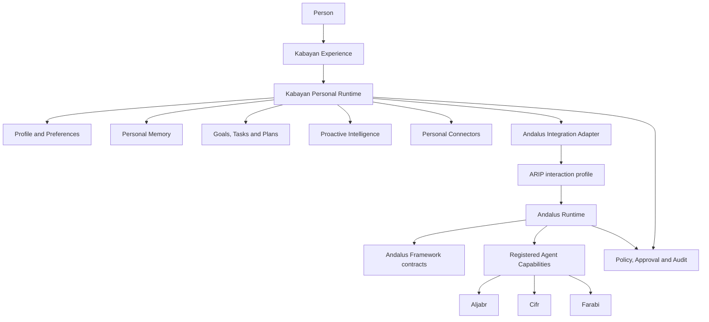

# Kabayan: Personal Agent Architecture

Status: M0 architecture baseline (proposed)
Owner: Kabayan product repository (to be created)
Related projects: Andalus Framework, Andalus Runtime, Aljabr, Cifr, Farabi

## Mission

Kabayan is a persistent personal AI agent that helps one person understand, organize, plan, and act across their digital life. It should build continuity across conversations and projects, offer useful proactive assistance, and remain understandable and controllable by its owner.

Kabayan is a product and personal-intelligence layer. It is not a replacement for Andalus, a general-purpose agent runtime, nor a new framework.

## System boundaries

| Project | Owns | Must not absorb |
|---|---|---|
| Andalus Framework | Reusable Java contracts, SPIs, portable agent capabilities, communication abstractions, memory/knowledge/security contracts | Kabayan product policy, personal UI, user-specific profile semantics |
| Andalus Runtime | Agent execution, orchestration, capability dispatch, run lifecycle, runtime policy, deployment, operational observability | Personal-assistant product experience or Kabayan's personal memory policy |
| Kabayan | Personal identity/profile, personal memory semantics, user-facing assistant, proactive personal workflows, personal integrations and approvals | General agent runtime, duplicate tool/plugin lifecycle, duplicate transport stack |
| Aljabr | Shared mathematical, statistical, ML and computational capabilities | Personal assistant orchestration or product workflows |
| Cifr / Farabi | Their specialist product capabilities | Kabayan's core identity and personal memory |

Kabayan consumes framework contracts and invokes Andalus Runtime. It may connect to Cifr, Farabi, and other ecosystem products through declared capabilities and policy-controlled integrations.

## Logical architecture

The diagram shows logical ownership, not a mandatory deployment topology. Kabayan and Andalus may run in one JVM, separate local processes, or remote infrastructure.

## Kabayan modules

Keep modules independently usable and avoid requiring the UI for headless deployments.

| Module | Responsibility |
|---|---|
| `kabayan-core` | Domain types, personal-agent identity, user/tenant boundaries, shared contracts |
| `kabayan-runtime` | Personal session lifecycle and coordination of Kabayan-owned services |
| `kabayan-memory` | Personal memory policies, capture, retrieval, consolidation, correction and lifecycle |
| `kabayan-profile` | Explicit profile, preferences, working style and consent settings |
| `kabayan-planner` | Goals, tasks, commitments and plans |
| `kabayan-proactive` | Trigger evaluation, reminders, suggestions and background personal workflows |
| `kabayan-connectors` | Email, calendar, files, messaging and other user-authorized sources |
| `kabayan-integrations-andalus` | ARIP client and mapping to Andalus capabilities and run lifecycle |
| `kabayan-security` | Personal data access, consent, approvals, export and deletion orchestration |
| `kabayan-api` | External API and event surfaces |
| `kabayan-app` | Web/desktop/voice experience |

Module names are a proposed starting boundary, not a requirement to create empty modules up front. Extract a module when it has a stable API and independent tests.

## Personal memory model

Kabayan owns the personal meaning and policy of memory; it should reuse Andalus Framework/Runtime storage, retrieval, indexing and knowledge infrastructure where suitable.

Four logical memory classes:

1. **Episodic** — what happened, when, in which conversation or activity, and with what source.
2. **Semantic** — facts, entities, concepts and relationships that appear stable enough to retain.
3. **Procedural** — preferences, working habits and recurring workflows.
4. **Prospective** — intentions, commitments, reminders, deadlines and future follow-ups.

Every retained item should carry provenance, confidence, timestamps, scope/owner, sensitivity classification, retention policy and correction/deletion lineage. These are logical categories and need not map to four physical databases.

Memory is not automatically truth. Distinguish user-confirmed facts from inferred or model-generated hypotheses. Provide ways to inspect, correct, suppress, export and delete retained information.

## Privacy, security and trust

- Enforce per-user and per-tenant isolation at every read, write, retrieval and connector boundary.
- Apply least-privilege connector scopes; do not treat a connected account as blanket consent.
- Make capture, retention, proactive use and external sharing separately configurable.
- Preserve source provenance and make consequential inferences reviewable.
- Require explicit approval for consequential external actions, financial/legal commitments, destructive changes, or sending content to other people unless the user has configured a narrowly scoped automation.
- Record auditable decisions for authentication, authorization, capability invocation, approvals, memory mutation and connector actions.
- Support data export and deletion, including derived indexes and caches, subject to clearly documented retention/legal constraints.
- Do not bypass authorization, policy or audit when using in-process communication.

## Andalus interaction strategy

Kabayan uses a typed integration adapter over the Andalus communication and runtime APIs. The proposed **ARIP (Andalus Runtime Interaction Profile)** defines the interaction semantics and efficient client/server mapping; it is not a competing agent protocol stack.

- Same JVM: direct typed asynchronous interfaces where lifecycle and security context can be preserved.
- Separate processes: reuse the existing Andalus gRPC APIs and streaming model where possible.
- HTTP: use existing REST APIs for compatibility, diagnostics and simple clients.
- MCP: use for third-party tools and interoperability, not as a mandatory internal Kabayan-to-Andalus hop.
- A2A/ANP: retain their existing purposes for agent-to-agent interoperability and network discovery; ARIP does not replace them.

Batch related operations and stream long-running runs/events. Never trade away policy evaluation, tenant context, approval checks or auditability to reduce overhead.

## Product capability pillars

1. Personal memory and continuity.
2. Conversational assistant and research support.
3. Proactive intelligence and reminders.
4. Personal workspace for projects, notes, tasks and plans.
5. Authorized automation across personal services.
6. Personal knowledge graph and cross-project context.

## Delivery roadmap

| Milestone | Outcome | Exit criteria |
|---|---|---|
| M0 — Architecture | Ownership, module boundaries, interaction profile, security and roadmap | Architecture and ADRs reviewed; no duplicate runtime or transport |
| M1 — Agent foundation | Sessions, typed Andalus client, streaming and run lifecycle | Kabayan can open a session, invoke a capability, observe/cancel a run |
| M2 — Memory | Four memory classes, provenance, profile and retrieval | User can inspect, correct, export and delete memory |
| M3 — Proactive | Event-driven triggers, scheduling, reminders and goal tracking | User-controlled proactive jobs with approvals and audit |
| M4 — Integrations | Email, calendar, files, messaging and external MCP tools | Per-connector scopes, consent and revocation |
| M5 — Experience | Web/desktop/voice, timeline, memory and approval UI | User can understand and control agent activity |
| M6 — Advanced intelligence | Multimodal context, cross-project synthesis, long-running workflows and local-first options | Privacy, resource and reliability targets validated |

M1 can proceed alongside finalization of the ARIP mapping. M2 depends on M1 identity/session context and on an explicit memory lifecycle contract. M3 depends on reliable run lifecycle and event delivery. M4 can proceed incrementally after the connector security model is established.

## Non-goals for M0/M1

- No new general-purpose agent runtime inside Kabayan.
- No new generic plugin, skill or capability registry.
- No new mandatory MCP server between Kabayan and Andalus.
- No custom wire protocol or serialization format before proving a gap in existing gRPC/REST/local APIs.
- No autonomous background actions without user-visible policy and controls.
- No premature microservice decomposition or empty module proliferation.

## M0 acceptance checklist

- [x] Product and infrastructure ownership are separated.
- [x] Personal memory classes and minimum lifecycle controls are defined.
- [x] Internal communication strategy reuses existing Andalus foundations.
- [x] Security and approval invariants are explicit.
- [x] Milestones and dependencies are documented.
- [ ] Create the dedicated `andalus-ai/kabayan` repository and move this document into its architecture documentation.
- [ ] Validate the proposed ARIP mapping against current Andalus Runtime REST/gRPC endpoints before freezing contracts.
