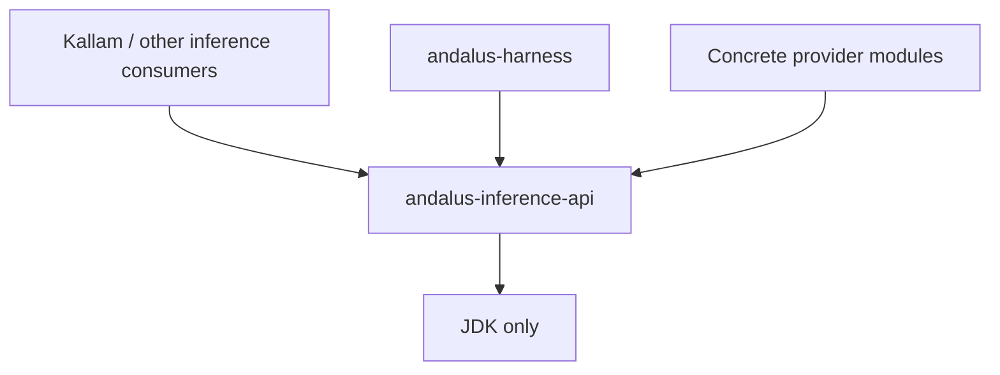

# Andalus Inference API

This module contains the provider-agnostic inference request, response, planning, runtime, and provider-adapter contracts used across Andalus integrations.

## Design intent

The inference contract is a foundational SPI. Consumers that only need to submit an inference request or implement a provider adapter should not have to depend on the full agent harness, knowledge graph, RAG, embedding, model runtime, or execution environment.

The module therefore:
- uses only the JDK;
- preserves the existing Java package names under `tech.kayys.andalus.harness.inference` for source/binary compatibility;
- owns `InferenceRuntime`, `InferenceProviderAdapter`, request/plan/result/usage contracts, and the default runtime/router;
- includes the inference planning contracts used to choose an execution plan;
- does not contain concrete model-provider integrations or credentials.

## Dependency direction



The full `andalus-harness` retains its broader agent orchestration, workspace, memory, knowledge, and governance capabilities. It depends on this module for inference contracts; the reverse dependency is forbidden.

## Maven coordinates

```xml
<dependency>
  <groupId>tech.kayys.andalus</groupId>
  <artifactId>andalus-inference-api</artifactId>
  <version>0.0.1</version>
</dependency>
```

## Build

From the repository root:

```bash
mvn -pl framework/andalus-inference-api -am -B -ntp clean verify
```

The module has no runtime dependencies and can be built without Gamelan, Aqli, Quarkus, or the rest of the Andalus runtime.

## Compatibility note

The inference classes were previously packaged inside `andalus-harness`. They are moved without changing their package or public type names. `andalus-harness` now depends on `andalus-inference-api`, preserving the types on its transitive classpath for existing consumers. Consumers should migrate their direct Maven dependency to this focused module to avoid pulling the full harness dependency graph.
