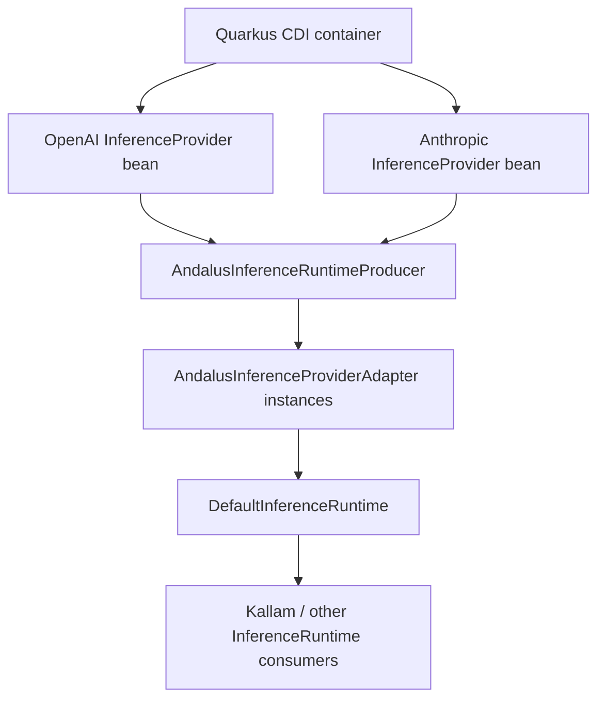

# Andalus Inference Provider Bridge — Quarkus

This optional module composes CDI-discovered legacy Andalus `InferenceProvider` beans into one `InferenceRuntime`.

## Composition



For each provider bean, the producer:
1. Reads the model IDs advertised by `listModels()`.
2. Resolves provider identity from each model's `ModelInfo.provider()`.
3. Rejects missing or inconsistent provider identity.
4. Rejects duplicate provider IDs instead of silently overwriting a provider.
5. Creates a single `DefaultInferenceRuntime` containing all resolved adapters.

A provider with no advertised models is skipped. If no provider beans are available, the produced runtime has no providers and returns the normal `PROVIDER_UNAVAILABLE` result when invoked. This keeps provider absence fail-closed without preventing applications that do not use model inference from starting.

## Scope

The module is optional and is the only part of the bridge stack that depends on Quarkus CDI. The inference API and plain Java bridge remain framework/runtime agnostic.

Applications that already expose their own `InferenceRuntime` should not include this producer module at the same time; expose one runtime composition root to avoid ambiguous CDI beans.

## Build

```bash
mvn -pl framework/andalus-inference-provider-bridge-quarkus -am -B -ntp clean verify
```
