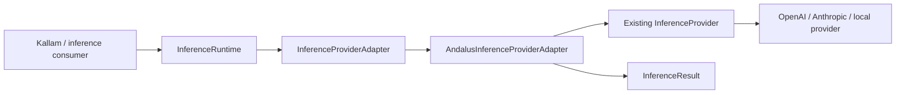

# Andalus Inference Provider Bridge

This module adapts existing `tech.kayys.andalus.inference.InferenceProvider` implementations to the lightweight `InferenceProviderAdapter` SPI consumed by `InferenceRuntime`.

## Architecture



The bridge keeps both contracts separate:
- The inference runtime SPI owns model routing, request constraints, standardized status, provider identity, and usage reporting.
- Existing Andalus providers continue to own vendor protocol, credentials, model-specific request encoding, and transport.
- The bridge maps between those contracts; it does not contain vendor HTTP clients.

## Usage

```java
InferenceProviderAdapter adapter =
    new AndalusInferenceProviderAdapter("openai", openAiInferenceProvider);

InferenceRuntime runtime = new DefaultInferenceRuntime(List.of(adapter));
```

The provider ID is explicit at composition time. The bridge only advertises models returned by the delegate's `listModels()`; it does not guess model support.

## Request mapping

- The plan model ID becomes the provider completion model.
- A map payload may contain `systemInstruction`; it becomes a system message. The remaining payload is serialized as the user message.
- Structured requests marked with `structured-json` request `json_object` output and are rejected if the provider returns anything other than a JSON object.
- Output-token limits, temperature, and top-p are forwarded.
- Only `kallam.*` plan and constraint metadata is forwarded. Arbitrary application attributes are intentionally excluded.

## Result mapping and scholarly safety

- The adapter returns the configured provider ID and the actual model ID reported by the provider (falling back to the requested model only if the provider omits it).
- Provider input/output token usage is mapped without estimation.
- The bridge copies `kallam.usage.reasoningTokens` only when the provider explicitly reports that exact metadata key. It never derives reasoning tokens from output-token totals.
- If a provider does not report reasoning-token usage, Kallam's analyzer will continue to reject the analysis as incomplete/partial under its existing policy.
- Kallam remains responsible for validating its versioned scholarly JSON schema, evidence IDs, methodology, and scholar-review boundary.

## Limitations

The existing `InferenceProvider.generateAsync` contract does not expose a transport cancellation handle. The runtime can enforce a timeout and request cancellation of its future, but this bridge cannot guarantee cancellation of an already-running vendor request. True transport cancellation requires a future cancellable provider API.

The bridge requests JSON mode through the legacy `CompletionRequest.responseFormat` field. A provider implementation must honor that field for native constrained output; the bridge additionally validates that the returned payload is a JSON object. Kallam performs the stricter schema and domain validation.

## Build

```bash
mvn -pl framework/andalus-inference-provider-bridge -am -B -ntp clean verify
```
